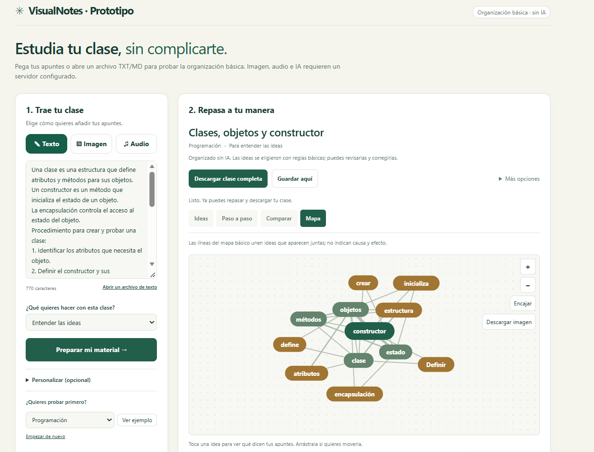
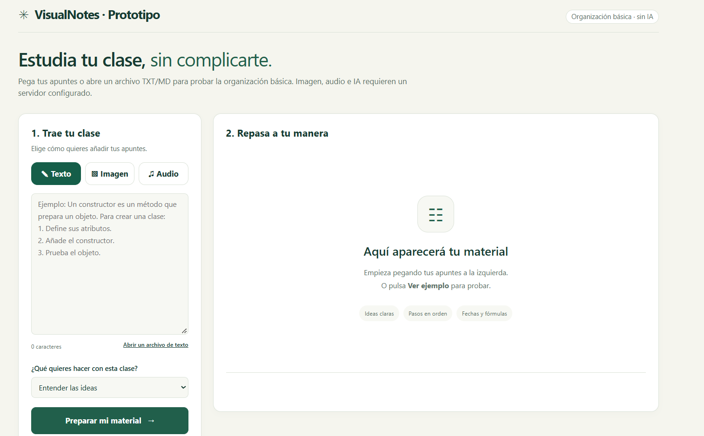

# VisualNotes AI

Plataforma web universitaria que convierte **audios de clase**, **fotos de pizarra/apuntes** y **texto** en un kit de estudio completo generado con IA: transcripción, contenido limpio, apuntes, palabras clave, mapa conceptual, resumen, quiz y documentos **Markdown** exportables a **PDF**.

> Proyecto académico del **Grupo 4 — Universidad Cenfotec**.
> Repositorio oficial: https://github.com/nexusdigitalsolutionspa-maker/visualnotesia

---

## 🌱 Comunidad de práctica y proyecto final

VisualNotes AI es también una comunidad de práctica: producimos, revisamos y compartimos kits de estudio para que otra persona pueda continuarlos sin nosotros.

### Cómo empezar a participar (resumen de [CONTRIBUTING.md](CONTRIBUTING.md))

La escalera es **observar → probar → aportar → facilitar**. Prueba la aplicación con la [guía rápida](recursos/guia-de-uso-rapida.md), cuenta en un **Issue** qué funcionó o en qué paso te trabaste y, si quieres ir más lejos, envía un **Pull Request** con código o documentación. No subas `.env`, claves ni datos personales.

Para leer más: [CONTRIBUTING.md](CONTRIBUTING.md).

### Estructura del repositorio

```
visualnotesia/
├── README.md                     ← propósito y cómo empezar a participar
├── CONTRIBUTING.md               ← escalera de participación y cómo contribuir
├── docs/
│   ├── mapa-de-comunidad.md      ← Entrega 1
│   ├── bitacora.md               ← activaciones, evidencias y ajustes
│   ├── plan-de-sostenibilidad.md ← Entrega 3
│   ├── retroalimentacion.md      ← qué comentarios recibieron y qué cambiaron
│   └── uso-de-ia.md              ← qué hizo la IA y qué decidieron ustedes
├── recursos/                     ← Entrega 2 (al menos 2 recursos)
└── imagenes/                     ← fotos, capturas o bocetos (opcional)
```

### Entregas y documentos

| Documento | Qué contiene según la guía |
|---|---|
| [Entrega 1 · Mapa de Comunidad](docs/mapa-de-comunidad.md) | Dominio, intención, participantes, trayectorias de participación, rituales y espacios |
| [Entrega 2 · Recursos reutilizables](recursos/) | Recursos con origen, usables sin el equipo y enlazados desde el README |
| [Entrega 3 · Plan de evolución y sostenibilidad](docs/plan-de-sostenibilidad.md) | Documento `Entrega-3.md`: cómo ejecutar, comprobar y continuar VisualNotes AI |
| [Bitácora de activación](docs/bitacora.md) | Activación ejecutada o ensayada, evidencias y ajustes |
| [Retroalimentación](docs/retroalimentacion.md) | Quién comentó, qué dijo, qué ajustamos y dónde se ve el cambio |
| [Uso de IA](docs/uso-de-ia.md) | Ideas propias, sugerencias de la IA y decisiones del equipo |

#### Recursos de la Entrega 2

- [Guía rápida: de una clase a un kit de estudio](recursos/guia-de-uso-rapida.md) — origen: experiencia de una persona nueva que no sabía por dónde empezar.
- [Plantilla de kit de estudio](recursos/plantilla-kit-de-estudio.md) — origen: falta de un formato común al compartir los resultados de Gemini.

### Imágenes

| Imagen | Archivo |
|---|---|
|  | `imagenes/recurso1.png` |
|  | `imagenes/recurso2.png` |

### Equipo

Integrantes del **Grupo 4 · IA y Sistemas** (detalle y capacidades en el [Mapa de Comunidad](docs/mapa-de-comunidad.md#3-comunidad)):

Cesar Adrian Villamil Alzamora · Said Enrique Mendoza Acevedo · Alice Alexandra Rojas Vergara · Samantha Valentina Matos Gutierrez · Josue Antonio Parfait Miranda

| Rol | Responsable | Responsabilidad |
|---|---|---|
| Facilitación | `[completar]` | Coordinar sesiones y dar la bienvenida |
| Documentación | `[completar]` | Bitácora y recursos |
| Código e IA | `[completar]` | Backend, integración con Gemini y despliegue |
| Revisión | `[completar]` | Revisar PRs y observar las señales de comunidad |

> El plan de sostenibilidad es [Entrega-3.md](docs/plan-de-sostenibilidad.md).

---

## 📚 Qué genera

A partir de una sola fuente (audio, imagen o texto):

- 📄 **Transcripción completa** (literal, sin omitir contenido)
- 🧹 **Contenido limpio y ordenado** por temas
- 📝 **Apuntes estructurados** en Markdown
- 🔑 **Palabras clave** para repaso y búsqueda
- 🗺️ **Mapa conceptual** en Mermaid (editable y exportable a SVG/PNG)
- 📌 **Resumen ejecutivo** y conceptos fundamentales
- ❓ **Quiz de autoevaluación** con respuestas
- 🔗 **Recursos recomendados** (videos, sitios y blogs)
- 📥 **Documento `.md`** listo para Obsidian/Notion y **exportación a PDF**

---

## 🧱 Stack tecnológico

| Capa | Tecnología |
|------|------------|
| Backend | **Python 3.12**, **FastAPI**, **Uvicorn** |
| Base de datos | **SQLite** + **SQLAlchemy** (almacenamiento local) |
| IA | **Google Gemini** vía `google-genai` |
| Frontend | HTML5, CSS3 y **JavaScript** vanilla |
| Diagramas | **Mermaid.js** |
| Markdown | **marked.js** |
| 3D (landing) | **Three.js** |
| Contenedores | **Docker** / **docker-compose** |
| Seguridad | `bcrypt` (hash), cabeceras HTTP, rate limiting, CSP |

---

## 📁 Estructura del proyecto

```
.
├── app.py                     # API FastAPI (rutas y seguridad)
├── database.py                # Modelos SQLAlchemy y conexión SQLite
├── gemini_service.py          # Integración con Google Gemini
├── requirements.txt           # Dependencias de Python
├── templates/
│   ├── index.html             # Aplicación principal
│   └── landing.html           # Página informativa / marketing
├── static/
│   ├── css/style.css
│   └── js/ (app.js, audio.js, diagram.js, auth.js)
├── marketing/                 # Scripts de capturas para el video
├── docs/                      # Mapa, bitácora, sostenibilidad, retroalimentación e IA
├── recursos/                  # Recursos reutilizables de la Entrega 2
├── imagenes/                  # Capturas y evidencia visual
├── Dockerfile
├── docker-compose.yml
├── render.yaml
├── .env.example
└── README.md
```

---

## 🔑 Cómo conseguir la API key de Gemini

La aplicación usa **Google Gemini** para el análisis de contenido. Necesitas una clave de API (hay un **plan gratuito**).

1. Entra a **Google AI Studio**: https://aistudio.google.com/app/apikey
2. Inicia sesión con tu cuenta de Google.
3. Pulsa **“Create API key”** (Crear clave de API).
4. Elige un proyecto de Google Cloud (o deja que se cree uno nuevo) y copia la clave generada.
5. Guarda esa clave como variable de entorno `GEMINI_API_KEY` (ver más abajo). **Nunca** la escribas en el código ni la subas al repositorio.

> 💡 Documentación oficial: https://ai.google.dev/gemini-api/docs

---

## ⚙️ Configuración

Copia el archivo de ejemplo y completa tus valores:

```bash
cp .env.example .env
```

Edita `.env`:

```env
GEMINI_API_KEY=tu_clave_de_gemini
ENABLE_AUTH=false
RATE_LIMIT_PER_MINUTE=20
MAX_UPLOAD_MB=25
```

### Variables de entorno

| Variable | Descripción | Default |
|----------|-------------|---------|
| `GEMINI_API_KEY` | Clave de la API de Gemini (**requerida** para la IA) | — |
| `GEMINI_MODELS` | Modelos separados por coma, con fallback | `gemini-flash-latest,...` |
| `ENABLE_AUTH` | Activa el inicio de sesión (futuro) | `false` |
| `ALLOWED_ORIGINS` | Orígenes CORS permitidos (coma). Vacío = mismo origen | — |
| `RATE_LIMIT_PER_MINUTE` | Límite de peticiones a la IA por IP | `20` |
| `MAX_UPLOAD_MB` | Tamaño máximo de archivo subido | `25` |
| `VISUALNOTES_DB` | Ruta de la base de datos SQLite | `./visualnotes.db` |

---

## 💻 Ejecución local (sin Docker)

```bash
# 1. Crear entorno virtual (recomendado)
python -m venv .venv
# Windows:
.venv\Scripts\activate
# Linux/macOS:
source .venv/bin/activate

# 2. Instalar dependencias
pip install -r requirements.txt

# 3. Configurar variables de entorno
cp .env.example .env   # y edita GEMINI_API_KEY

# 4. Iniciar el servidor
python -m uvicorn app:app --host 127.0.0.1 --port 8000
```

Abre:
- Landing (página de inicio): http://127.0.0.1:8000
- Aplicación: http://127.0.0.1:8000/app

---

## 🐳 Ejecución con Docker

```bash
# Construir y levantar
docker compose up --build

# Abrir en: http://localhost:8000
```

O manualmente:

```bash
docker build -t visualnotes-ai .
docker run --rm -p 8000:8000 --env-file .env \
  -v "$(pwd)/data:/app/data" visualnotes-ai
```

> El volumen `./data` conserva la base de datos SQLite entre reinicios.

---

## 🚀 Despliegue

### Render (recomendado, incluye `render.yaml`)

1. Sube el repositorio a GitHub.
2. En [Render](https://render.com) crea un **New → Web Service** y conecta el repo.
3. Render detecta el `Dockerfile` automáticamente.
4. En **Environment**, agrega `GEMINI_API_KEY` con tu clave.
5. Deploy. El healthcheck está en `/api/health`.

> ⚠️ En planes gratuitos el sistema de archivos es efímero: la base SQLite se reinicia con cada deploy. Para persistir, monta un disco persistente o usa un plan con volumen.

### Railway / Fly.io / VPS

- **Railway:** “Deploy from GitHub repo” → detecta el Dockerfile → añade `GEMINI_API_KEY`.
- **Fly.io:** `fly launch` (usa el Dockerfile) y `fly volumes create data` para persistencia; monta el volumen en `/app/data`.
- **VPS con Docker:** clona el repo, crea `.env` y ejecuta `docker compose up -d --build`.

---

## 🔒 Seguridad

- La **API key de Gemini** se lee **solo** de variables de entorno; nunca está en el código.
- El archivo `.env` está en `.gitignore` (no se sube).
- Cabeceras de seguridad: `CSP`, `X-Frame-Options`, `X-Content-Type-Options`, `Referrer-Policy` y `Permissions-Policy`.
- **Rate limiting** por IP en el endpoint de IA.
- **Límite de tamaño** de archivos subidos.
- Los errores internos no se exponen al cliente.
- El **inicio de sesión está deshabilitado** por defecto (modo local). Los endpoints de cuentas solo se activan con `ENABLE_AUTH=true`.

¿Encontraste un problema de seguridad? Revisa [SECURITY.md](SECURITY.md) antes de publicarlo.

---

## 🐞 Reportar problemas

Usa la pestaña **[Issues](https://github.com/nexusdigitalsolutionspa-maker/visualnotesia/issues)** del repositorio:

- 🐛 **Bug report** — algo no funciona.
- ✨ **Feature request** — ideas y mejoras.

---

## 🤝 Contribuir

Las contribuciones son bienvenidas. Lee [CONTRIBUTING.md](CONTRIBUTING.md) para saber cómo proponer cambios.

---

## 📄 Licencia

Este proyecto está bajo la licencia **MIT**. Ver [LICENSE](LICENSE).
