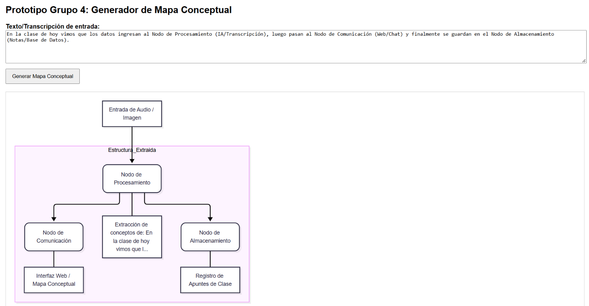
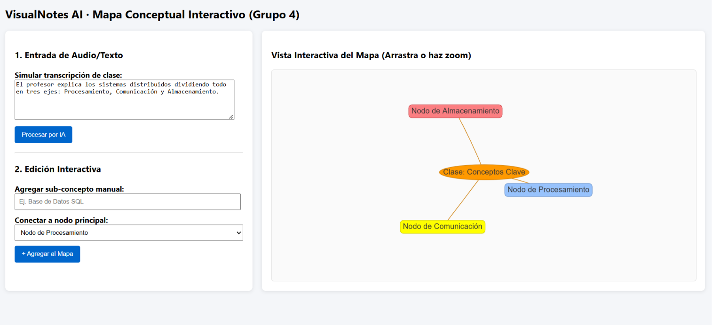
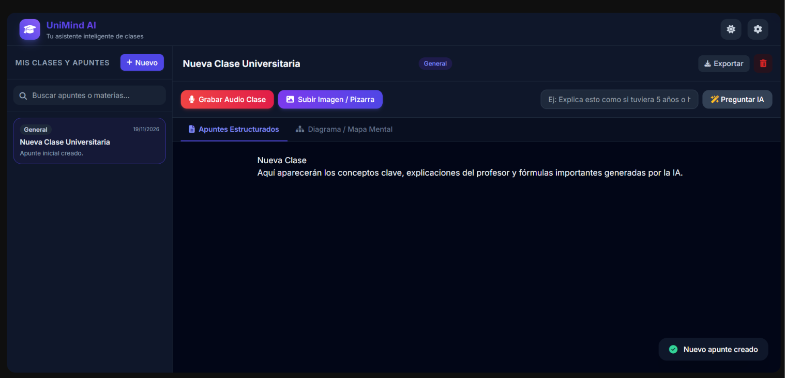

# Bitácora de activación — VisualNotes AI

> **Regla del proyecto:** registrar solo lo que ocurrió. Si una actividad no se pudo realizar, se anota y se explica qué se hará. Una bitácora honesta vale más que una inventada.
> Todos los campos de esta bitácora están completados con lo ocurrido.

## Evolución del prototipo

Antes de la reunión del 4 de noviembre, el equipo pasó por tres versiones del prototipo. Estas imágenes son la evidencia de ese proceso:

| Fecha | Versión | Evidencia | Qué pasó |
|---|---|---|---|
| 2026-10-01 | Prototipo 1 |  | Primera versión, la más sencilla: permitía introducir texto y mostrar una representación visual básica de los conceptos |
| 2026-10-15 | Prototipo 2 |  | Se mejoró un poco la interfaz y la forma de mostrar los conceptos |
| 2026-10-29 | Prototipo 3 |  | Se le dio un poco más de forma, pero todavía no nos decidíamos por el nombre del proyecto |

> El 1 de octubre es la fecha indicada por el equipo. Las fechas del 15 y del 29 de octubre se estimaron a partir de la secuencia de versiones; ajustarlas si fue distinto.

## Activación 1

| Campo | Registro |
|---|---|
| Estado | Ejecutada |
| Fecha | 2026-11-04 (miércoles de la semana antepasada) |
| Persona anfitriona | No se designó una: fue una reunión de trabajo del equipo |
| Participantes | Los 6 integrantes del Grupo 4, que somos la comunidad por el momento |
| Formato | Reunión del equipo |
| Duración | 2:00 Horas |
| Evidencia | Propuestas registradas en el [Mapa de Comunidad](mapa-de-comunidad.md) y en [Entrega-3.md](plan-de-sostenibilidad.md); evolución visual en [imagenes/](../imagenes/) |

> Los nombres documentados en el mapa son cinco; actualizar esa lista a seis personas cuando se confirme el sexto integrante.

### Interacción concreta 1

- **Quiénes participaron:** los 6 integrantes del equipo.
- **Qué pasó, con palabras concretas:** al inicio de la reunión, una persona propuso mejorar la aplicación en la parte visual. Otras personas respondieron señalando partes concretas del resultado —el mapa conceptual y la vista de transcripción— que costaba leer, y el grupo acordó tomar esa mejora como primera prioridad.
- **Evidencia:** la necesidad de representaciones visuales queda registrada en el [Mapa de Comunidad](mapa-de-comunidad.md#6-representación).

### Interacción concreta 2

- **Quiénes participaron:** los 6 integrantes del equipo.
- **Qué pasó, con palabras concretas:** después de la propuesta visual, otra persona pidió agregar más mapas. El equipo comentó qué representaciones serían útiles y, a continuación, se sumó la propuesta de que el resumen saliera en PDF. Las tres ideas quedaron en la conversación y la de PDF se registró como pendiente.
- **Evidencia:** la exportación a PDF aparece como pendiente en [Entrega-3.md](plan-de-sostenibilidad.md#qué-aprendimos-y-qué-falta-resolver).

### Hipótesis vs. observación

| Hipótesis antes de la activación | Lo que pasó realmente |
|---|---|
| Esperábamos que la reunión se centrara en cómo generar apuntes con IA | La conversación giró hacia cómo se ve y se entrega el resultado: la parte visual, los mapas y el PDF |
| Creíamos que la aplicación ya estaba lista para que otra persona la usara sin ayuda | Detectamos que faltaban mejoras visuales y una salida en PDF para compartir y revisar el kit |
| Al llegar a la tercera versión ya teníamos definido el nombre del proyecto | En el prototipo 3 todavía no nos decidíamos por el nombre; la decisión quedó pendiente |

### Ajuste para la siguiente activación

Seguir el orden que surgió en la reunión: **1)** mejorar la parte visual de la aplicación, **2)** agregar más mapas y **3)** lograr que el resumen se exporte en PDF. En la próxima sesión mostraremos el avance del primer punto con un ejemplo real y registraremos qué cambió.

**Responsable del ajuste:** equipo Grupo 4 (sin responsable único asignado)
**Fecha en que se aplicará:** siguiente reunión del equipo

## Actividades no realizadas

| Actividad prevista | Motivo | Qué se hará en su lugar |
|---|---|---|
| Ninguna | — | — |

## Historial de activaciones

| # | Fecha | Anfitrión | Ajuste surgido | Evidencia |
|---|---|---|---|---|
| 1 | 2026-10-01 | Equipo Grupo 4 | Primera versión sencilla | [Prototipo 1](../imagenes/Prototipo1.png) |
| 2 | 2026-10-15 | Equipo Grupo 4 | Mejora parcial de la interfaz | [Prototipo 2](../imagenes/Prototipo2.png) |
| 3 | 2026-10-29 | Equipo Grupo 4 | Más forma; nombre aún no decidido | [Prototipo 3](../imagenes/Prototipo3.png) |
| 4 | 2026-11-04 | No se designó (reunión del equipo) | Mejora visual → más mapas → resumen en PDF | [Mapa de Comunidad](mapa-de-comunidad.md), [Entrega-3.md](plan-de-sostenibilidad.md) |

---

Relacionado: [Mapa de Comunidad](mapa-de-comunidad.md) · [Plan de sostenibilidad](plan-de-sostenibilidad.md).
